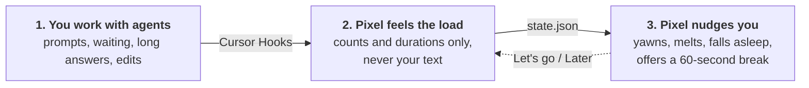
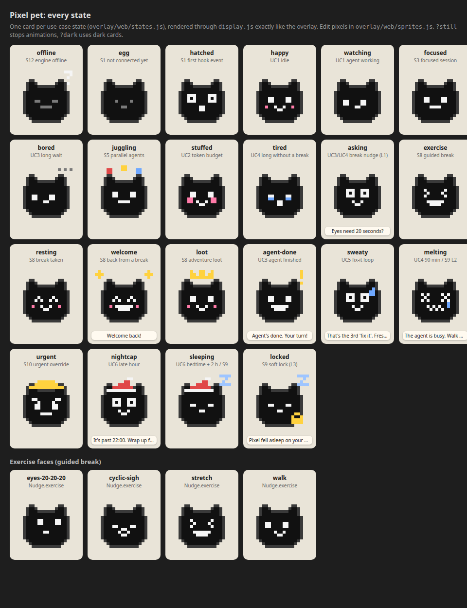

<p align="center">
  
</p>

<h1 align="center">Demolition Daddy</h1>

<p align="center">
  <b>Other coding pets eat your tokens. Ours eats your breaks.</b><br>
  Pixel is a pixel-art cat that floats over Cursor, gets tired as you supervise AI agents, and sends you to touch grass.
</p>

**The problem:** with agents, coding turns into nonstop supervision: decide, wait, read, decide again. In METR's study, developers using AI (mostly in Cursor) were **19% slower but believed they were 20% faster** ([METR 2025](https://metr.org/blog/2025-07-10-early-2025-ai-experienced-os-dev-study/)). You can't feel your own overload. Pixel can.

## How it works



Pixel asks for a break only at natural boundaries: while the agent is thinking, or right after it stops. Never mid-typing.

## Try it in 30 seconds

One copy-paste, then a black cat appears at the bottom-right of your screen. Requirements, controls and troubleshooting are in [For judges](#for-judges) below.

```bash
git clone https://github.com/Fluxonius/demolition-daddy.git && cd demolition-daddy/overlay && npm install && npm run demo
```

## What makes it different

| | Other coding pets (Codogotchi, cursor-gotchi, CursorToys Pet, tokengotchi) | Break timers (Stretchly, Workrave) | **Demolition Daddy** |
|---|---|---|---|
| Rewards | More tokens, more prompts | Nothing | **Breaks only** |
| Sees your AI agent | Yes | No, only clock and keystrokes | **Yes, through Cursor Hooks** |
| When it interrupts | Never, it wants you working | On a fixed timer | **While the agent thinks, or right after it stops** |
| When you step away | Gets sad or dies | Nothing | **Rests and recovers with you** |

- **Mirror, not a nag.** Pixel never dies and never guilts you. Every nudge has a "Later".
- **Guided 60-second breaks.** 20-20-20 for your eyes, a cyclic sigh, a stretch or a short walk, and Pixel does it with you.
- **Optional soft prompt-lock.** At the top of the ladder Pixel can fall asleep on your Send button. It's off by default, `!urgent` always gets through, and it fails open.
- **Private by design.** Only lengths, counts and durations are stored, never prompt or response text. Nothing leaves your machine.

<table>
  <tr>
    <td></td>
    <td></td>
  </tr>
</table>

## Why it matters

- **Supervising AI is what wears you down.** In the "AI brain fry" survey of 1,488 workers, oversight of AI was the factor most linked to fatigue: +12% fatigue and +19% information overload ([HBR/BCG 2026](https://hbr.org/2026/03/when-using-ai-leads-to-brain-fry)).
- **AI makes each task easier, but fatigue grows faster from one task to the next** than without AI ([CHI 2026, "When Help Hurts"](https://dl.acm.org/doi/full/10.1145/3772318.3791176)).
- **Short breaks work.** Micro-breaks raise vigor and reduce fatigue ([Albulescu et al. 2022, PLOS ONE meta-analysis](https://journals.plos.org/plosone/article?id=10.1371%2Fjournal.pone.0272460)), and interruptions at task boundaries are far less annoying than mid-task ones ([Bailey & Konstan 2006](https://interruptions.net/literature/Bailey-CHB06_1.pdf)).
- **What we don't claim:** we show *load*, not a diagnosis, and we don't promise to fix "decision fatigue". That effect failed a large multi-lab replication ([Friese et al. 2019](https://journals.sagepub.com/doi/10.1177/1088868318762183)).

Status: hackathon build. The overlay and every pet state run today, driven by a fake engine for the demo. The Cursor hooks (`hooks/`) and the real load engine (`engine/`) are in progress. Design: [foundation spec](docs/foundation-spec.md).

## For judges
**You need:** macOS (also works on Linux/Windows), [Node.js](https://nodejs.org) **22.12 or newer** (`node -v`), git. Internet access for the first `npm install`.

**Run it (one copy-paste):**
```bash
git clone https://github.com/Fluxonius/demolition-daddy.git && cd demolition-daddy/overlay && npm install && npm run demo
```
A small black pixel cat appears at the **bottom-right of your screen**, floating above all windows. `npm run demo` drives it with a fake engine, so it reacts immediately: every 3 s it moves through happy → focused → tired (with a "Let's go / Later" nudge) → melting → sleeping → resting. The first run downloads Electron (~1 min).

**Try:** drag the pet anywhere; click it to pet it; click **Let's go** on a nudge to see the pet do the exercise.

**Quit:** right-click the pet → **Quit pet**, or the tray/menu-bar icon → **Quit pet**, or `Ctrl+C` in the terminal.

**Connect real Cursor activity:** not ready yet. The Cursor hooks (`hooks/`) and the engine (`engine/`) that turn agent activity into `~/.cursor-pet/state.json` are still in progress. Once they land: start the engine, then run `npm start` (instead of `npm run demo`) to show the real state.

**Troubleshooting**
- `npm install` fails or Electron complains about the Node version: update Node to 22.12+.
- The window doesn't show: use the menu-bar icon → **Show / hide pet** or **Move to bottom-right**. On macOS it may sit behind a full-screen app; switch to a normal desktop.
- It says "waiting for state…" or "engine offline": nothing is writing `state.json`. Use `npm run demo`, or run `npm run fake` in a second terminal next to `npm start`.
- Can't run Electron: `npm run serve` (with `npm run fake` in another terminal) and open http://127.0.0.1:4517/ in a browser or in Cursor's Browser tab (File > New Browser).
- See every pet face at once: open `overlay/web/preview.html` in a browser.

## Run the pet (overlay)
Cursor's Agents Window doesn't load VS Code extensions, so the pet is a transparent, always-on-top Electron window on your desktop. It watches `~/.cursor-pet/state.json` (override with `CURSOR_PET_DIR`).

```bash
cd overlay && npm install
npm run demo         # pet + fake engine in one command (scratch state dir)
npm start            # floating pet, bottom-right; right-click or tray icon to quit
npm run fake         # optional: fake state.json that cycles through all moods
npm run serve        # fallback: open http://127.0.0.1:4517/ in Cursor's Browser tab (File > New Browser)
```

More in [overlay/README.md](overlay/README.md).

## Docs
- [Foundation spec](docs/foundation-spec.md): vision, integration decision, scenarios, architecture, event contract, pet state model, team plan.
- [Feature specs](docs/specs/): one file per feature, built on the foundation spec. Start from [TEMPLATE.md](docs/specs/TEMPLATE.md).
- [AGENTS.md](AGENTS.md): repo conventions (English only in the repo), how to claim a role, and path ownership.

## Roles and layout
| Role ID | Name | Main folders |
|---|---|---|
| `ui` | Design & UI | [`overlay/`](overlay/) (optional: [`extension/`](extension/)`src/ui/`, `webview/`, `media/`) |
| `hooks` | Cursor hooks & events | [`hooks/`](hooks/), `.cursor/hooks.json`, `contract/events.ts` |
| `pet` | Pet behavior & glue (integrator) | [`engine/`](engine/) incl. the runner that writes `state.json`, [`contract/`](contract/) steward (optional: `extension/src/glue/`, extension manifest) |

Data flow: Cursor hooks → `~/.cursor-pet/events.jsonl` → engine runner → `~/.cursor-pet/state.json` → overlay. The `state.json` contract is in [foundation spec §4.4.1](docs/foundation-spec.md#441-statejson-file-contract-pet-writes-ui-and-hooks-read).
