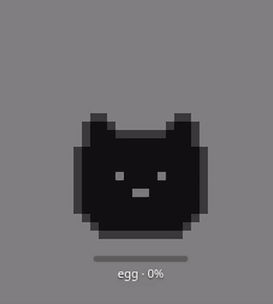
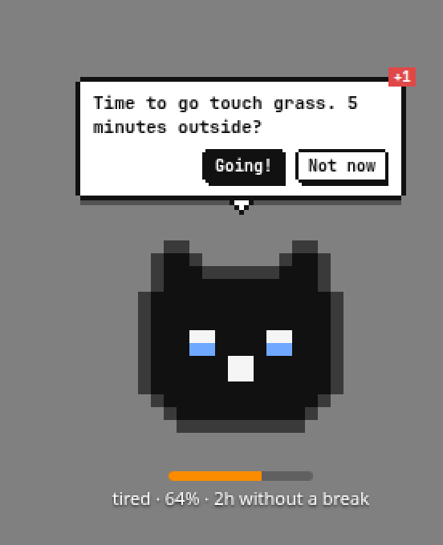

<p align="center">
  
</p>

<h1 align="center">NapCat</h1>

<p align="center"><i>by team Demolition Daddy</i></p>

<p align="center">
  <b>Other coding pets eat your tokens. Ours eats your breaks.</b><br>
  Pixel is an AI agent that's on <i>your</i> side: a pixel-art cat friend that watches over your mental state while you work with coding agents, and sends you to touch grass.
</p>

<p align="center"><b>Hackathon track: Multiplayer, human + agent collaboration.</b> Your coding agents do the work; Pixel looks after the human.</p>

**Why:** coding with agents is nonstop supervision: decide, wait, read, decide again. Developers using AI were **19% slower but felt 20% faster** ([METR 2025](https://metr.org/blog/2025-07-10-early-2025-ai-experienced-os-dev-study/)). You can't feel your own overload. Pixel can.

## How it works

1. **Cursor Hooks capture your work signals:** prompts, agent turns, waiting time, edits, session length. Only counts and durations, never your text.
2. **An AI agent (via the Cursor CLI) reads those metrics** and estimates how tired you are.
3. **It picks Pixel's state:** happy, focused, tired, melting, asleep.
4. **Pixel gives advice** while the agent thinks or right after it stops, never mid-typing: a speech bubble ("time to go touch grass") or a guided 60-second break (eyes, breathing, stretch). Every nudge has a "Later".

Tune it to your taste: right-click Pixel → **Settings…**

<p align="center"></p>

## Try it

**macOS:** download [NapCat-universal.dmg](https://github.com/Fluxonius/demolition-daddy/releases/latest/download/NapCat-universal.dmg), drag it to Applications, then right-click → **Open** (it's unsigned). On first launch NapCat starts its engine and plays a simulated scenario; click **AI** on the pet to watch the agent's reasoning.

**Any OS, from source:**

```bash
git clone https://github.com/Fluxonius/demolition-daddy.git && cd demolition-daddy/overlay && npm install && npm run demo
```

A black cat appears at the bottom-right of your screen. Details in [For judges](#for-judges).

## What's different

Other Cursor pets (Codogotchi, cursor-gotchi, tokengotchi) grow when you use more AI. Break timers (Stretchly, Workrave) only see the clock. **Pixel sees your agent and rewards only rest.**

Backed by: [HBR/BCG "AI brain fry"](https://hbr.org/2026/03/when-using-ai-leads-to-brain-fry) (supervising AI is the most draining part), [CHI 2026](https://dl.acm.org/doi/full/10.1145/3772318.3791176) (fatigue builds faster with AI), [micro-break meta-analysis](https://journals.plos.org/plosone/article?id=10.1371%2Fjournal.pone.0272460) (short breaks reduce fatigue).

Status: hackathon build. Live today: Cursor hooks, the load engine with the Cursor CLI AI layer (falls back to local rules), the overlay with every pet state, bubble nudges, settings, and the Agent Inspector with simulated events. Next: escalation policy and the soft prompt-lock. Design: [foundation spec](docs/foundation-spec.md).

## For judges
**macOS app (no Node, no npm):**
1. **Download** [NapCat-universal.dmg](https://github.com/Fluxonius/demolition-daddy/releases/latest/download/NapCat-universal.dmg) (Apple Silicon + Intel; [.zip](https://github.com/Fluxonius/demolition-daddy/releases/latest/download/NapCat-universal.zip) and older builds on the [Releases page](https://github.com/Fluxonius/demolition-daddy/releases)).
2. **Install:** open the .dmg and drag **NapCat** to **Applications**.
3. **Open:** the app is unsigned, so the first time **right-click NapCat → Open → Open**. If macOS says the app "is damaged" or still refuses, run this once in Terminal and open it again:
   ```bash
   xattr -cr "/Applications/NapCat.app"
   ```
4. **See it react:** a small black pixel cat appears at the **bottom-right of your screen**. There is no Dock icon; the app lives in the **menu bar** (a small dark circle). The app runs the real engine itself (no terminal). On the first launch, before `~/.cursor-pet/state.json` exists, it plays a 60 s scripted story in a sandbox: fresh → focused → tired (with a "Let's go / Later" nudge) → break → welcome back. The old fake-state cycle is still at menu-bar icon (or right-click the pet) → **Demo mode (fake states)**.
5. **Try:** drag the pet anywhere; click it to pet it; click **Let's go** on a nudge to see the exercise.
6. **See the agent think:** hover the pet and click **AI** (or right-click → **Demo / Agent Inspector…**). Three live panes show the hook events from `events.jsonl`, the engine's reasoning from `agent-log.jsonl` (what it received, the Cursor CLI prompt and answer, load, mood and why, with an **AI · CURSOR CLI** or **LOCAL RULES** badge), and the resulting pet state, nudge and your clicks.
   Click **▶ Play scenario** or one of the **Simulate** buttons. They append `SIMULATED` events to a sandbox `events.jsonl`, and the real engine and AI analyze them. **Back to live** returns to your real hooks.
   If the Cursor CLI isn't installed or logged in (`agent login`), the header says so, and the pet runs on the local rules engine, labelled **LOCAL RULES**.
7. **Quit:** menu-bar icon or right-click the pet → **Quit pet**.

### How to verify it works (2 minutes)

The demo uses **simulated** Cursor events, but everything after them is real: the same engine and AI that handle your live hooks.

1. Open the Inspector: hover the cat → **AI**.
2. Check the header: **SANDBOX** means simulated events, **LIVE** means your real Cursor hooks. The AI badge says whether decisions come from the **Cursor CLI** or the **local rules** fallback.
3. Click **▶ Play scenario** and watch the three columns from left to right:
   - **Events:** hook events arrive (`beforeSubmitPrompt`, `afterAgentResponse`, `stop`…), each marked `SIMULATED`.
   - **Agent reasoning:** what the engine received (session length, minutes since the last break, prompts and agent output read in the last hour, frustrated prompts, parallel chats, hour of day), the Cursor CLI prompt and answer, the load score 0–100, and why it picked that mood.
   - **Pet:** the resulting state and nudge; the cat on screen changes at the same moment (happy → focused → tired with a break bubble → resting → happy).
4. Try one cause at a time: **Simulate** "Token budget exceeded", "90 min without break", "3 parallel agents" or "Late night", and see a new reasoning entry and a different reaction.
5. Click a button in the cat's bubble: the click appears in the Pet column, and the engine stops nudging.
6. Real mode: after `agent login` and `node hooks/install.mjs`, click **Back to live** and send a prompt in Cursor. Real `REAL HOOK` events appear, and the badge turns **AI · CURSOR CLI**.

**Connect to Cursor** (from a clone, Node 22.18+): install the hooks, run the engine, then start the pet with demo mode off.
```bash
node hooks/install.mjs                 # adds the pet hooks to ~/.cursor/hooks.json (--uninstall to remove)
node engine/scripts/run.mjs            # events.jsonl -> ~/.cursor-pet/state.json every 5 s
node engine/scripts/run.mjs --llm      # optional: also ask the Cursor CLI (`agent login` first); falls back to rules
```
In Cursor, reload the window and start a new chat; `~/.cursor-pet/events.jsonl` should grow with each prompt.

**From source instead** (any OS; needs [Node.js](https://nodejs.org) **22.12+**, git, internet for the first `npm install`):
```bash
git clone https://github.com/Fluxonius/demolition-daddy.git && cd demolition-daddy/overlay && npm install && npm run demo
```
A small black pixel cat appears at the **bottom-right of your screen**, floating above all windows. `npm run demo` drives it with a fake engine, so it reacts immediately: every 3 s it moves through happy → focused → tired (with a "Let's go / Later" nudge) → melting → sleeping → resting. The first run downloads Electron (~1 min).

**Try:** drag the pet anywhere; click it to pet it; click **Let's go** on a nudge to see the pet do the exercise.

**Quit:** right-click the pet → **Quit pet**, or the tray/menu-bar icon → **Quit pet**, or `Ctrl+C` in the terminal. With real hooks and engine running, use `npm start` instead of `npm run demo`.

**Troubleshooting**
- `npm install` fails or Electron complains about the Node version: update Node to 22.12+.
- The window doesn't show: use the menu-bar icon → **Show / hide pet** or **Move to bottom-right**. On macOS it may sit behind a full-screen app; switch to a normal desktop.
- It says "waiting for state…" or "engine offline": nothing is writing `state.json`. Start the engine (`node engine/scripts/run.mjs`), use `npm run demo`, or run `npm run fake` in a second terminal next to `npm start`.
- Can't run Electron: `npm run serve` (with `npm run fake` in another terminal) and open http://127.0.0.1:4517/ in a browser or in Cursor's Browser tab (File > New Browser).
- See every pet face at once: open `overlay/web/preview.html` in a browser.

## Run the pet (overlay)
Cursor's Agents Window doesn't load VS Code extensions, so the pet is a transparent, always-on-top Electron window on your desktop. It watches `~/.cursor-pet/state.json` (override with `CURSOR_PET_DIR`).

```bash
cd overlay && npm install
npm run demo         # pet + fake engine in one command (scratch state dir)
npm start            # floating pet, bottom-right; right-click or tray icon to quit
npm run fake         # optional: fake state.json that cycles through all moods
npm run serve        # fallback: open http://127.0.0.1:4517/ in Cursor's Browser tab (File > New Browser)
npm run dist:mac     # macOS only: unsigned universal .dmg/.zip in overlay/dist/ (CI does this on v* tags)
```

More in [overlay/README.md](overlay/README.md).

## Docs
- [Foundation spec](docs/foundation-spec.md): vision, integration decision, scenarios, architecture, event contract, pet state model, team plan.
- [Feature specs](docs/specs/): one file per feature, built on the foundation spec. Start from [TEMPLATE.md](docs/specs/TEMPLATE.md).
- [AGENTS.md](AGENTS.md): repo conventions (English only in the repo), how to claim a role, and path ownership.

## Roles and layout
| Role ID | Name | Main folders |
|---|---|---|
| `ui` | Design & UI | [`overlay/`](overlay/) (optional: [`extension/`](extension/)`src/ui/`, `webview/`, `media/`) |
| `hooks` | Cursor hooks & events | [`hooks/`](hooks/), `.cursor/hooks.json`, `contract/events.ts` |
| `pet` | Pet behavior & glue (integrator) | [`engine/`](engine/) incl. the runner that writes `state.json`, [`contract/`](contract/) steward (optional: `extension/src/glue/`, extension manifest) |

Data flow: Cursor hooks → `~/.cursor-pet/events.jsonl` → engine runner → `~/.cursor-pet/state.json` → overlay. The `state.json` contract is in [foundation spec §4.4.1](docs/foundation-spec.md#441-statejson-file-contract-pet-writes-ui-and-hooks-read).
