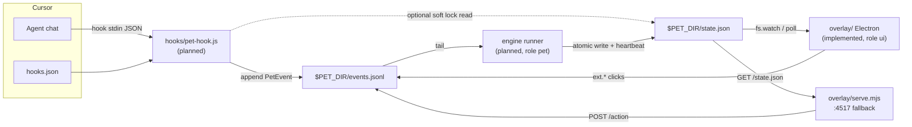

# Demolition Daddy — Architecture Overview

For the hackathon team. Mapped from `github.com/Fluxonius/demolition-daddy` at commit `d381a5a` (`main`, 2026-11-05). Spec source of truth: `docs/foundation-spec.md` (v1.1). Prefer that doc for product detail; this page is the shared mental model.

**Status in one line:** design is solid and shared; **only `overlay/` has runnable code**. `hooks/`, `engine/`, `contract/` (types/fixtures), and `extension/` are README stubs. The overlay can demo moods via `npm run fake`.

---

## Purpose

A Tamagotchi-style pet that lives **next to Cursor** and mirrors cognitive load while you supervise AI coding agents. It gets tired with prompts, long answers, edits, aborts, and time without a break — and recovers when *you* rest.

Pitch: *"Other coding pets eat your tokens. Ours eats your breaks."*

Principles that shape the architecture: local-only privacy (lengths/flags, never prompt text), fail-open hooks, interrupt only at task boundaries, soft prompt-lock opt-in if at all.

---

## High-level system



`$PET_DIR` = `~/.cursor-pet/` (override with `CURSOR_PET_DIR`).

**Data ownership:**
- `hooks` writes hook-sourced `PetEvent`s
- `ui` (overlay) appends `ext.*` events for clicks
- `pet` (engine) is the only writer of `state.json`
- Overlay / hooks only *read* `state.json`

---

## Major components

| Folder | Role | What it is | Code today? |
|---|---|---|---|
| `overlay/` | `ui` | Electron always-on-top pet + localhost Browser-tab fallback | **Yes** — main runnable surface |
| `hooks/` | `hooks` | Cursor hook script + installer into `~/.cursor/hooks.json` | **No** — README only; no `.cursor/hooks.json` yet |
| `engine/` | `pet` | Pure TS load reducer, nudge policy, replay/time-warp, standalone runner | **No** — README only |
| `contract/` | split (see below) | Shared TS types + fixtures | **No** — README only |
| `extension/` | optional stretch | VS Code/Cursor extension (focus/typing, Connect UX) | **No** — README only; Agents Window doesn't load extensions |
| `docs/` | all / `pet` stewards | Foundation + feature specs | Specs present |

### Role IDs (who owns what)

| Role | Owns | Decides |
|---|---|---|
| `ui` | `overlay/` (optional `extension/src/ui/`, `webview/`, `media/`) | How it looks |
| `hooks` | `hooks/`, `.cursor/hooks.json`, `contract/events.ts`, event fixtures | What we can observe |
| `pet` | `engine/`, `contract/state.ts` + `actions.ts` + `states.json`, repo meta; merges | When/what to nudge; integrator |

---

## What is actually implemented (`overlay/`)

Entry points:

| Command | Entry | Behavior |
|---|---|---|
| `npm start` | `overlay/main.js` | Electron window 220×260, transparent, always-on-top, tray |
| `npm run serve` | `overlay/serve.mjs` | HTTP on `127.0.0.1:4517` — open in Cursor Browser tab |
| `npm run fake` | `overlay/scripts/fake-state.mjs` | Cycles moods into `state.json` (stand-in for engine) |
| `npm test` | `overlay/test/overlay.test.js` | Watcher + action→event mapping |

Key modules:

- `lib/pet-dir.js` — resolve `CURSOR_PET_DIR`, `readState()`, `watchState()` (`fs.watch` + 1 s poll)
- `lib/actions.js` — map UI messages → `ext.*` `PetEvent`, append to `events.jsonl`
- `preload.js` — `window.petHost` (`onState`, `send`, `dragBy`, `showMenu`)
- `web/` — pet page (`index.html`, `pet.css`, `pet.js`); mood class `mood-<mood>`; offline if `updatedAt` > 2 min old

User actions already wired to events (`src: "ext"`, `data.window: "overlay"`):

| UI message | Event |
|---|---|
| Let's go / `startBreak` | `ext.breakStart` |
| Later / `snooze` | `ext.snooze` |
| `urgent` | `ext.urgentStart` |
| click pet / `feed` | `ext.petInteraction` |
| calibrate | `ext.calibrate` |

---

## Planned pipeline (not coded yet)

### 1. Hooks → `events.jsonl`
- Planned: `hooks/pet-hook.js` (stdin JSON → one `PetEvent` line; always exit 0; always valid JSON)
- Planned: `hooks/install.mjs` merges into `~/.cursor/hooks.json`
- Dogfood: project `.cursor/hooks.json` (file **missing** on `main`)
- Soft lock (open decision): hook may read `state.json.lock` if fresh (&lt; 2 min)

### 2. Engine → `state.json`
- Planned: `createPetEngine` in `engine/src/` (no `vscode` import)
- Planned runner e.g. `engine/scripts/run.mjs`: tail log → reduce → atomic write + ≥30 s heartbeat
- Planned: `engine/scripts/replay.mjs` for time-warp demo (`--speed 60`)
- Load / moods / nudge ladder: specified in foundation §4.5–§4.6; MVP use cases in `docs/specs/pet-use-cases.md` (UC1–UC6)

### 3. Contract
Planned files (none present):

| File | Author | Contents |
|---|---|---|
| `contract/events.ts` | `hooks` | `PetEvent`, hook + `ext.*` types |
| `contract/state.ts` | `pet` | `PetState`, `Nudge`, `PetEngine`, webview messages |
| `contract/actions.ts` | `pet` | `NudgeChannel`, `UiBridge` |
| `contract/fixtures/*.jsonl` | `hooks` | calm / overload sessions |
| `contract/fixtures/states.json` | `pet` | one state per mood (and exercises) |

### 4. Optional extension
Stretch only. Would host focus/typing `ext.*` signals and Connect UX in classic Editor. Not required for Agents Window demo.

---

## Data flow (happy path)

1. User sends a prompt in Cursor → hook fires `beforeSubmitPrompt`
2. Hook appends a length/flag-only event to `events.jsonl`
3. Engine runner tails the log, updates load/mood/nudge, writes `state.json`
4. Overlay watches the file and re-renders mood, load bar, bubble
5. User clicks **Let's go** → overlay appends `ext.breakStart` → engine decays load → mood `resting`

**IPC is files only** between processes. Overlay does **not** import `engine/`. No network telemetry in the product design.

---

## Tech stack

| Piece | Stack | Notes |
|---|---|---|
| Overlay | Node ≥ 18, Electron `^45` (devDep only) | Only folder with `package.json` / lockfile |
| Hook | Plain Node, **zero deps** | Must stay sync and fast |
| Engine | Pure TypeScript, `node --test` | Planned; no vscode |
| Extension | VS Code/Cursor + esbuild bundle | Optional stretch |
| Shared types | TypeScript in `contract/` | Planned; additive-only PRs |
| Repo packaging | **No** root `package.json` | Each role owns its deps |

---

## Entry points (who starts what)

Demo today (UI only):

```bash
cd overlay && npm install
CURSOR_PET_DIR=/tmp/pet npm run fake   # terminal 1
CURSOR_PET_DIR=/tmp/pet npm start      # terminal 2 — or npm run serve
```

Target demo (once engine/hooks land; Q12 still open):

```text
node engine/scripts/run.mjs          # pet — write state.json
cd overlay && npm start              # ui  — show pet
# hooks installed via project or ~/.cursor/hooks.json
```

---

## Key protocols

### `PetEvent` (`events.jsonl`, one JSON object per line)
- `v: 1`, `ts`, `src: 'hook' | 'ext' | 'replay'`, `type`, optional `conv` / `gen`, `data` (chars, flags, status, …)
- Append-only; skip malformed lines
- Never store prompt/response text

### `PetState` (`state.json`)
- Fields the overlay uses **now**: `updatedAt`, `mood`, `load`, `reasons[0]`, `nudge` (bubble if `level >= 1`)
- Atomic write (temp + rename); heartbeat every ≤30 s; stale after 2 min → UI "engine offline", hook ignores lock
- Moods: `egg | happy | focused | tired | melting | sleeping | resting`

### Soft prompt-lock (optional, undecided — Q1)
- Engine sets `lock` in state; hook enforces at `beforeSubmitPrompt` if state is fresh
- Bypass: `!urgent`; limited `bypassesLeft` per day; fail-open

---

## External services / APIs

| Dependency | Role in product |
|---|---|
| **Cursor Hooks** ([docs](https://cursor.com/docs/hooks)) | Primary signal source for agent activity |
| **Electron** | Desktop host for the pet window |
| **Cursor built-in Browser** | Fallback UI surface (`localhost:4517`) |
| VS Code Extension API | Optional only (focus/typing, Connect) |
| Cursor plugins / MCP | Post-hackathon packaging / bonus ideas |
| Team Admin API / Enterprise OTEL | Discussed in `docs/specs/cursor_activity_assistant_implementation_brief.md` as **out-of-MVP research**; not part of current architecture |

Nothing leaves the machine in the MVP design. No cloud backend.

---

## Docs map (where to dig deeper)

| Doc | Use |
|---|---|
| `docs/foundation-spec.md` | Vision, integration decision v1.1, contracts, load model, team plan, open questions |
| `docs/specs/pet-use-cases.md` | Engine MVP use cases UC1–UC6 (draft; proposes additive contract fields) |
| `docs/specs/ui-electron-overlay.md` | Overlay behavior + why not Canvas/extension |
| `docs/specs/cursor_activity_assistant_implementation_brief.md` | Broader sensor research (editor APIs, tokens); **not** the shipped MVP shape |
| `AGENTS.md` | Role claim rules, ownership, hard invariants |
| `README.md` | How to run the overlay |

---

## Open questions / risks (discussion)

From foundation §6 plus what’s visible in the tree:

1. **Soft prompt-lock (Q1)** — wow for demo vs uninstall risk; decide at checkpoint 1.
2. **Critical path gap** — pipeline is broken until `contract/` + `hooks/pet-hook.js` + engine runner land; overlay alone only shows fake state.
3. **Natural breaks without extension (Q11)** — Agents Window loses focus/typing signals; default is ≥3 min event gap, or OS idle from Electron.
4. **Who starts the engine (Q12)** — two terminals vs overlay spawning the runner.
5. **Pet name / art (Q2)** — default “Pixel”, emoji/CSS; placeholder SVG already in `overlay/web/`.
6. **Multi-window / last writer of `state.json` (Q3)** — one log, many consumers; need a clear writer rule once engines multiply.
7. **Use-case vs foundation drift** — `pet-use-cases.md` proposes `overlays`, `estTokens`, `agent-done` kind, settings; not yet reflected in frozen foundation types.
8. **macOS overlay** — Linux/Xvfb verified; transparency/tray/always-on-top over full-screen Cursor **not yet confirmed on macOS**.
9. **Implementation brief vs product** — the brief sketches extension+desktop receiver and richer editor sensors; team should treat foundation v1.1 + overlay path as the agreed MVP, and the brief as optional future input.
10. **Privacy discipline** — easy to regress once hooks see real prompt text; keep length/flag-only as a hard gate in review.

---

## Unknowns / not mappable from this checkout

- Real Cursor hook payload shapes for this team’s Cursor version (to be verified when `pet-hook.js` lands).
- Whether token/cost fields exist on hooks (Q9 — default to `chars`).
- Exact `engine/scripts/run.mjs` path/name (spec says “e.g.”).
- Any private team research notes outside the repo (foundation cites Russian notes in a team store; not in this git tree).
